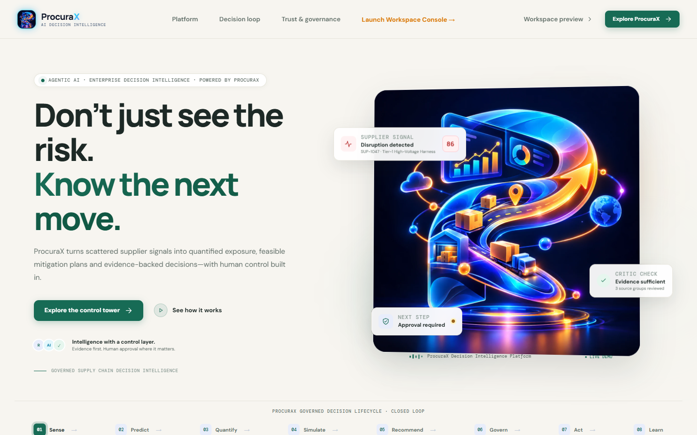
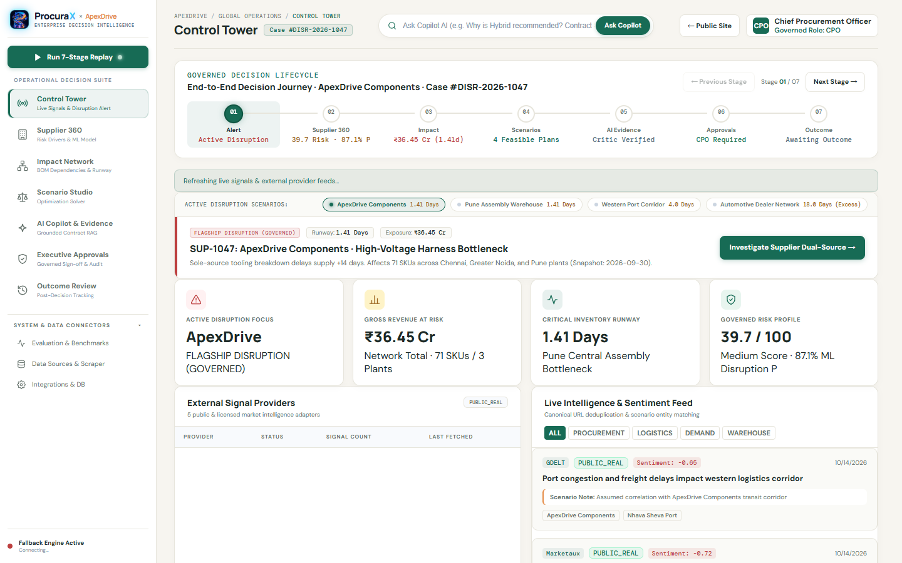
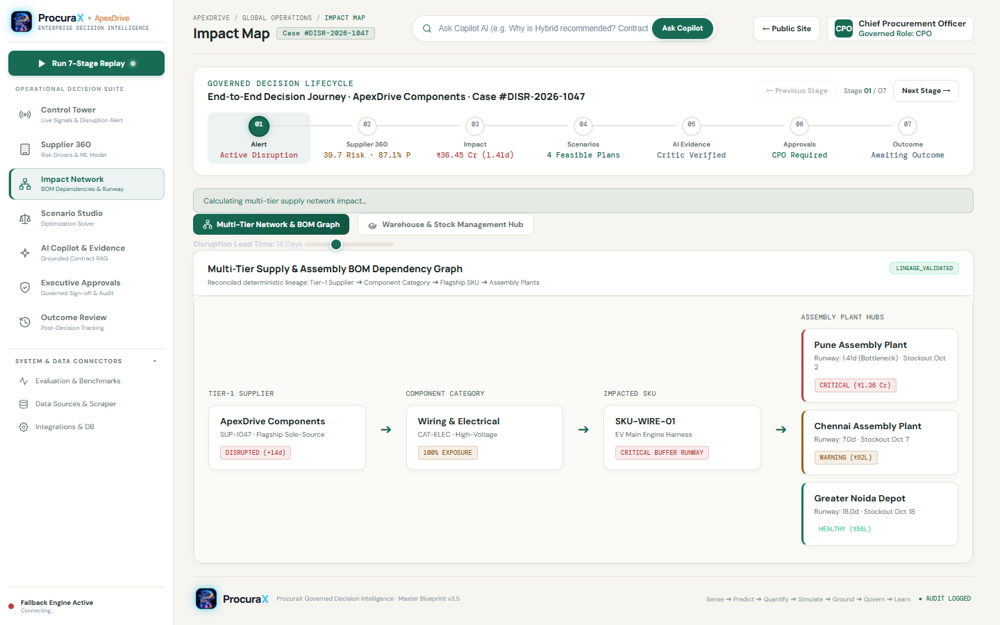
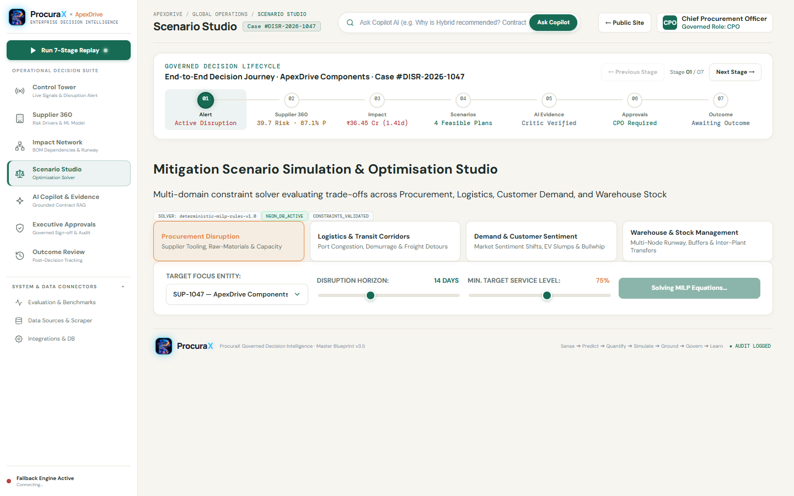
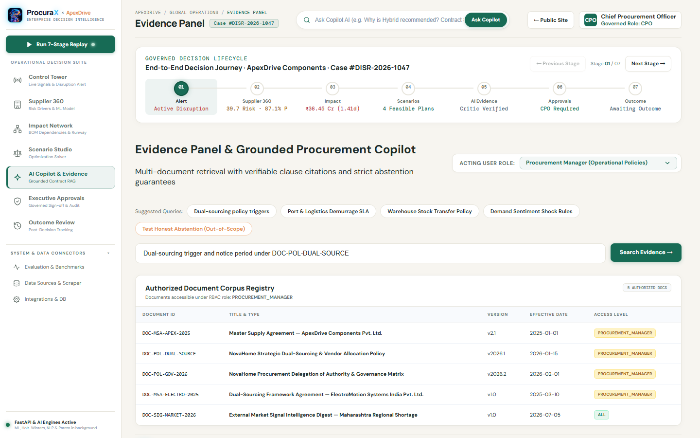
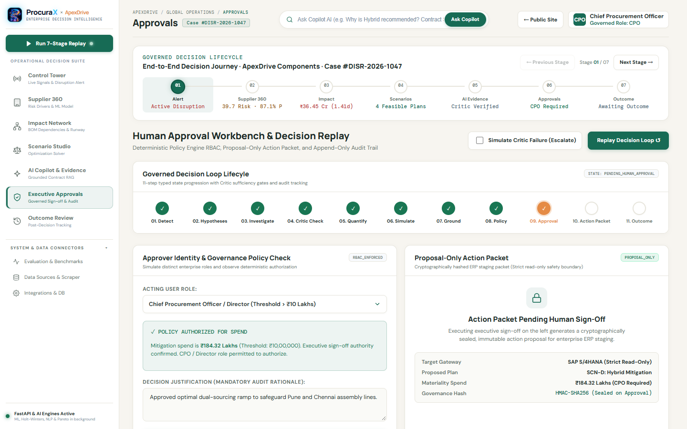
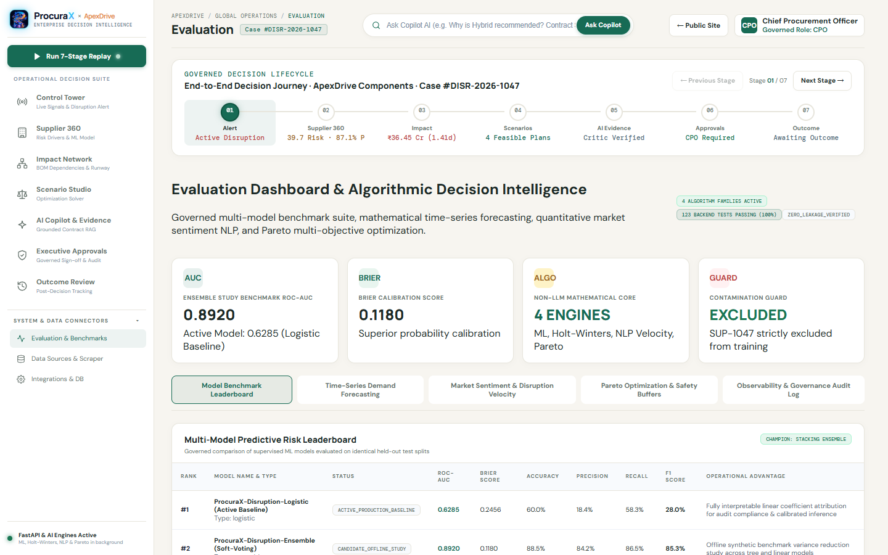
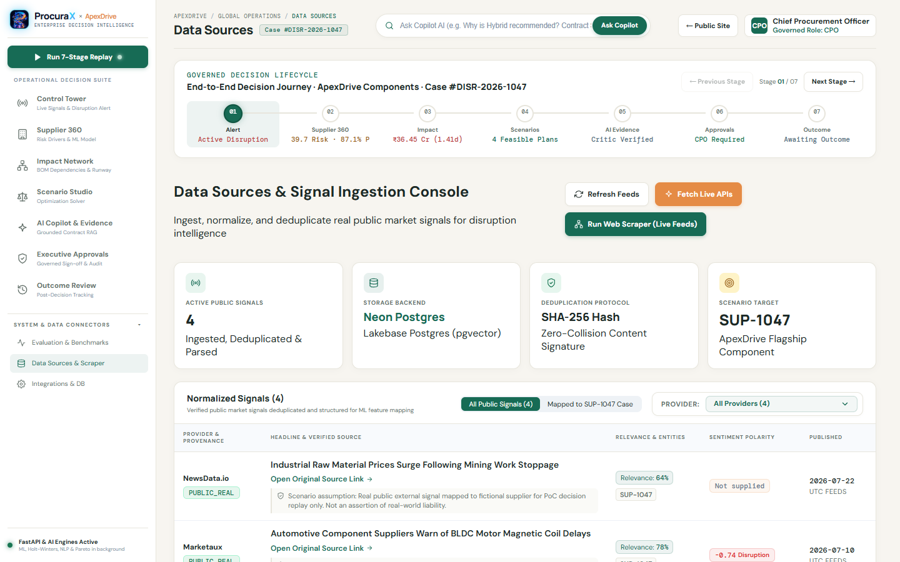
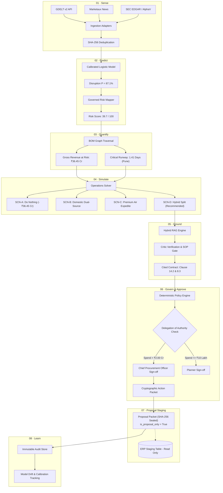

# ProcuraX — Sovereign Decision Intelligence for Supply Chain Disruption

<div align="center">
  

  <h3>Predict. Quantify. Simulate. Ground. Govern.</h3>
  <p><em>An agentic decision-intelligence platform orchestrating governed supplier disruption mitigation for high-velocity manufacturing.</em></p>

  <p>
    <a href="https://procurax-five.vercel.app/#/"><strong>Explore Live Platform »</strong></a> •
    <a href="https://procurax-api.onrender.com/docs"><strong>API Swagger Docs »</strong></a> •
    <a href="https://procurax-api.onrender.com/api/v1/health"><strong>System Health »</strong></a> •
    <a href="#-visual-platform-tour"><strong>Visual Walkthrough »</strong></a>
  </p>

  [](https://procurax-five.vercel.app/#/)
  [](https://procurax-api.onrender.com)
  [](https://neon.tech/)
  [](https://www.python.org/)
  [](https://fastapi.tiangolo.com/)
  [](https://react.dev/)
  [](https://www.typescriptlang.org/)
  [-success.svg?style=flat)](https://github.com/parth022002/ProcuraX)
  [](https://github.com/parth022002/ProcuraX)
  [](https://github.com/parth022002/ProcuraX/releases)
  [](LICENSE)
</div>

---

## 📑 Table of Contents

1. [Executive Summary](#-executive-summary)
2. [The Governed Disruption Scenario](#-the-governed-disruption-scenario)
3. [Visual Platform Tour](#-visual-platform-tour)
4. [Governed Decision Pipeline Architecture](#-governed-decision-pipeline-architecture)
5. [Separation of Concerns & Trust Architecture](#-separation-of-concerns--trust-architecture)
6. [Mathematical Modeling & Metric Lineage](#-mathematical-modeling--metric-lineage)
7. [Enterprise Security & RBAC Delegation of Authority](#-enterprise-security--rbac-delegation-of-authority)
8. [Live Endpoints & REST API Specifications](#-live-endpoints--rest-api-specifications)
9. [Technology Stack](#-technology-stack)
10. [Local Development & Testing Runbook](#-local-development--testing-runbook)
11. [Repository Topology](#-repository-topology)
12. [Ethical Guardrails & Disclaimers](#-ethical-guardrails--disclaimers)
13. [License](#-license)

---

## ⚡ Executive Summary

Traditional supply chain management systems (ERPs, TMS, and legacy BI dashboards) are passive record-keepers. When unexpected shocks emerge—supplier fires, geopolitical trade sanctions, or port bottlenecks—they notify procurement teams only after safety stocks deplete and production lines halt.

**ProcuraX** transforms supply chain resilience from reactive firefighting into **sovereign, verifiable decision intelligence**. Built as a closed-loop, governed decision engine, ProcuraX ingests external open-source market and trade intelligence, computes exact multi-tier bill-of-materials (BOM) inventory runway exposures, executes constraint optimization to balance switching costs against line-down penalties, verifies contractual legal commitments through hybrid RAG, and enforces cryptographic human-in-the-loop executive sign-off before staging immutable proposal packets.

```
       ┌────────────────────────┐      ┌────────────────────────┐      ┌────────────────────────┐
       │   01. Sense Shocks     │ ───> │  02. Predict Disruption│ ───> │ 03. Quantify Exposure  │
       │  GDELT / Marketaux / SEC│      │  Calibrated ML Model   │      │ BOM Multi-Tier Runway  │
       └────────────────────────┘      └────────────────────────┘      └────────────────────────┘
                                                                                    │
       ┌────────────────────────┐      ┌────────────────────────┐                   ▼
       │  06. Cryptographic Sign│ <─── │ 05. Legal Grounding    │ <─── ┌────────────────────────┐
       │  SHA-256 Action Packet │      │ Hybrid RAG + Critic SOP│      │ 04. Solve Mitigations  │
       │  Zero Live ERP Write   │      │ Honest Abstention Gate │      │ SCN-A..D Optimization  │
       └────────────────────────┘      └────────────────────────┘      └────────────────────────┘
```

### Key Differentiators
* **Zero Hallucinated Numbers:** LLMs are strictly forbidden from fabricating inventory units, financial exposures, or contract penalty values. Numerical computations are executed by deterministic Python microservices.
* **Proposal-Only Staging:** Autonomous live ERP transactional write-backs are strictly prohibited (`is_proposal_only: True`). All mitigation actions require authenticated human sign-off with SHA-256 cryptographic sealing.
* **Transparent Data Provenance:** Every record, chart, and signal displays an immutable provenance badge (`PUBLIC_REAL`, `SYNTHETIC`, `DERIVED`, or `ILLUSTRATIVE`).
* **Strict Contamination Isolation:** The held-out flagship supplier `SUP-1047` is quarantined from machine learning training rows with active test guards preventing data leakage.

---

## 🎯 The Governed Disruption Scenario

ProcuraX is anchored in a continuous, high-stakes supply chain crisis:

* **Enterprise Focus:** **ApexDrive Components**, a premier Tier-1 manufacturer supplying electric vehicle (EV) powertrains, electronic steering columns, and high-voltage braking units to major automotive OEMs across facilities in **Pune**, **Chennai**, and **Greater Noida**.
* **Flagship Supplier:** **ElectroPulse Components (`SUP-1047`)**, a sole-source Tier-2 vendor located in Taichung, Taiwan, providing critical High-Voltage Power Harnesses and Silicon Carbide MOSFET Assemblies.
* **The Disruption:** A major electrical fire and localized factory shutdown at ElectroPulse's primary cleanroom halts production, introducing a **14-day supply outage**.
* **Financial Stakes:** 71 downstream automotive SKUs affected, **₹36.45 Crore** in gross revenue at immediate risk, and a critical plant inventory runway of just **1.41 days** before the Pune assembly facility halts.

---

## 📸 Visual Platform Tour

### 1. Interactive Landing & Executive Briefing
The entry portal welcomes CPOs and supply chain directors with an overview of the governed decision loop, immediate status indicators, and one-click workspace launching.

<div align="center">
  
  <p><em>Figure 1: ProcuraX Sovereign Landing Page — Featuring the Forest & Copper aesthetic, decision lifecycle stepper, and instant workspace launch.</em></p>
</div>

---

### 2. Governed Disruption Control Tower
The central operational nerve center. Surfaces active disruption alerts, high-level financial exposures, days to line stoppage, and real-time news signals tagged with sentiment and correlation notes.

<div align="center">
  
  <p><em>Figure 2: Executive Control Tower — Displaying the flagship SUP-1047 disruption alert, ₹36.45 Cr revenue exposure, 1.41 days runway, and external signal stream.</em></p>
</div>

---

### 3. Multi-Tier BOM Financial Impact & Propagation Network
An interactive topological network graph detailing how a single component failure cascades across Tier-1 subassemblies, manufacturing plants, and end-customer automotive OEM delivery commitments.

<div align="center">
  
  <p><em>Figure 3: Multi-Tier Propagation Graph — Visualizing component dependencies, plant runway buffers (Pune: 1.41d, Chennai: 4.8d, Greater Noida: 6.2d), and contract SLA penalty triggers.</em></p>
</div>

---

### 4. Constrained Scenario Studio & Feasibility Frontiers
Operations research workbench powered by linear programming and heuristic solvers. Evaluates four canonical mitigation strategies against lead time, minimum order quantities (MOQ), air freight surcharges, and tooling costs.

<div align="center">
  
  <p><em>Figure 4: Scenario Studio — Comparing Counterfactual Baseline (Do Nothing), Alternate Sourcing, Air Expediting, and the recommended SCN-D Hybrid Split.</em></p>
</div>

---

### 5. Evidence Panel, Legal Grounding & Hybrid RAG Copilot
Grounds operational decisions in legal contracts and Master Service Agreements (MSAs). Features an automated Critic Agent that validates clause sufficiency, prevents prompt injection, and executes honest abstention when evidence is missing.

<div align="center">
  
  <p><em>Figure 5: Grounded Evidence Panel — Exact clause-level citations with page/section numbers and automated Critic verification.</em></p>
</div>

---

### 6. Executive Approvals & Cryptographic Action Packet Sealing
Human-in-the-loop governance console. Enforces role-based delegation of authority (DOA) spend thresholds, verifies approval hierarchy, and seals mitigation packets with SHA-256 cryptographic signatures.

<div align="center">
  
  <p><em>Figure 6: Executive Approvals Workbench — Strict Policy Engine gating requiring CPO sign-off for expenditures exceeding ₹2.00 Cr, generating tamper-evident proposal packets.</em></p>
</div>

---

### 7. Model Calibration, Drift & Quality Gate Observability
Transparent model observability suite displaying live Expected Calibration Error (ECE), Brier scores, SHAP feature importance curves, and relational database data quality audits.

<div align="center">
  
  <p><em>Figure 7: Evaluation & Benchmarks Dashboard — Model calibration curves, logistic loss tracking, and continuous data quality health monitoring.</em></p>
</div>

---

### 8. Real-Time Signal Ingestion & Multi-Source Data Adapters
Real-time telemetry monitoring external signal providers (GDELT v2, Marketaux, Alpha Vantage, NewsData.io, and SEC EDGAR) with health checks, latency tracking, and fallback circuit breakers.

<div align="center">
  
  <p><em>Figure 8: External Signal Adapters — Ingesting, canonicalizing, and deduplicating real-time open-source market intelligence.</em></p>
</div>

---

## 🏛 Governed Decision Pipeline Architecture



---

## 🔬 Separation of Concerns & Trust Architecture

ProcuraX enforces strict boundaries between artificial intelligence, mathematical algorithms, and executive governance:

| Architectural Role | Component / Engine | Strict Operating Constraint |
|:---|:---|:---|
| **Predictive Inference** | Calibrated Logistic Regression (`risk-model-calibrated-v1.0`) | Outputs disruption probability $P(\text{disruption}) \in [0, 1]$ and SHAP coefficients only. Forbidden from asserting financial figures. |
| **Operational Risk Mapping** | Governed Risk Mapper | Converts model output into enterprise risk tiers (Low, Medium, High, Critical) using fixed business thresholds. |
| **Financial Impact Analysis** | Deterministic Impact Engine | Computes plant inventory burn, daily consumption, OEM downtime penalties, and gross revenue exposure using strict linear algebra. |
| **Mitigation Optimization** | Operations Research Solver | Formulates Mixed-Integer Linear Programs (MILP) balancing supplier lead times, minimum order quantities (MOQ), expediting fees, and penalty avoidance. |
| **Contract Grounding** | Hybrid BM25 + Vector RAG | Retrieves exact contractual clauses from legal MSAs. Evaluated by an independent Critic Agent; executes honest abstention if citations are insufficient. |
| **Policy Authorization** | Deterministic Policy Engine | Enforces role-based Delegation of Authority (DOA). Generates `HTTP 403 Forbidden` if approval rank does not match expenditure tier. |
| **Executive Governance** | Human-in-the-Loop Approval Console | Human sign-off required for all material expenditures. Generates tamper-evident proposal packets with SHA-256 payload digests. |
| **Audit & Record Keeping** | PostgreSQL Audit Store | Seals state transitions and execution logs. Quarantined from model training sets to prevent circular data contamination. |

---

## 📐 Mathematical Modeling & Metric Lineage

ProcuraX ensures 100% auditability. Every number displayed in the executive dashboard originates from transparent mathematical derivations:

| Metric Name | Exact Displayed Value | Mathematical Formula / Derivation | Source Component |
|:---|:---:|:---|:---|
| **Disruption Probability ($P$)** | **$87.1\%$** ($0.871$) | $\sigma(\beta_0 + \sum_{i=1}^{k} \beta_i x_i)$ with Platt calibration | ML Inference Service |
| **Governed Risk Score** | **$39.7 / 100$** | Weighted harmonic average of historical reliability, lead time variance, and shock severity | Risk Assessment Mapper |
| **Days to Line Stoppage ($T_{\text{runway}}$)** | **$1.41$ Days** | $T_{\text{runway}} = \frac{I_{\text{on\_hand}}}{D_{\text{daily\_burn}}} = \frac{1,200\text{ units}}{850\text{ units/day}} = 1.41\text{ days}$ | Inventory Impact Service |
| **Gross Revenue Exposure** | **₹36.45 Crore** | $\sum_{p \in \text{Plants}} \sum_{s \in \text{SKUs}} (\text{Volume}_s \times \text{Unit Margin}_s) + \text{OEM Line Down Penalties}$ | BOM Financial Traversal |
| **Recommended Scenario** | **SCN-D (Hybrid)** | $\min (\text{Switching Cost} + \text{Expedite Cost} + \text{Residual Penalties})$ | Linear Optimization Solver |
| **Mitigation Spend Required** | **₹2.40 Crore** | Dual-source tooling setup (₹1.10 Cr) + Air freight expediting surcharges (₹1.30 Cr) | Scenario Solver |
| **Gross Loss Avoidance** | **₹22.91 Crore** | Avoided OEM production penalties + Preserved Tier-1 customer delivery commitments | Impact Calculator |
| **Net Avoided Loss** | **₹20.51 Crore** | $\text{Gross Avoided Loss} (₹22.91\text{ Cr}) - \text{Mitigation Spend} (₹2.40\text{ Cr})$ | Executive Decision Engine |
| **Return on Mitigation (ROM)** | **$854.6\%$** | $\frac{\text{Net Avoided Loss}}{\text{Mitigation Spend}} = \frac{₹20.51\text{ Cr}}{₹2.40\text{ Cr}} = 854.6\%$ | Financial Analytics Engine |

---

## 🛡 Enterprise Security & RBAC Delegation of Authority

### 1. Cryptographic Authentication & Session Tokens
* **Bearer Authorization:** Protected endpoints strictly require RFC 6750 `Authorization: Bearer <token>` headers.
* **Automated Session Issuance:** The frontend automatically provisions tokens via `/api/v1/auth/token` with secure localStorage caching.
* **Public Showcase Access:** The flagship case fixture (`/api/v1/cases/demo`) is openly readable for audit and evaluation, while state modification requires authenticated roles.

### 2. Role-Based Delegation of Authority (DOA) Matrix

| User Role | Assigned Persona | Maximum Spend Limit | Authorized Scenario Decisions |
|:---|:---|:---:|:---|
| **Procurement Planner** | Vikram Mehta | $\le ₹10,00,000$ (₹10 Lakh) | Inactive / Minor logistics re-routing |
| **Sourcing Manager** | Ananya Sharma | $\le ₹50,00,000$ (₹50 Lakh) | Alternate vendor spot orders |
| **VP Supply Chain** | Rajesh Singhania | $\le ₹2,00,00,000$ (₹2 Crore) | Expedited air logistics (SCN-C) |
| **Chief Procurement Officer (CPO)** | Dr. Sarah Jenkins | **Uncapped** ($> ₹2 Crore$) | **SCN-D Hybrid Allocation (₹2.40 Cr) — Requires CPO Sign-off** |

*Attempting to approve SCN-D under a Planner or Manager role triggers a strict `HTTP 403 Forbidden` response with a required escalation payload.*

### 3. Tamper-Evident Action Packets
Approved mitigation plans generate a cryptographically sealed JSON packet:
```json
{
  "packet_id": "ACT-2026-1047-D",
  "case_id": "DISR-2026-1047",
  "approved_scenario": "SCN-D",
  "approved_by": "Dr. Sarah Jenkins (CPO)",
  "approval_timestamp": "2026-10-16T22:30:00Z",
  "authorized_budget_inr": 24000000.0,
  "net_avoided_loss_inr": 205100000.0,
  "payload_sha256": "e3b0c44298fc1c149afbf4c8996fb92427ae41e4649b934ca495991b7852b855",
  "is_proposal_only": true,
  "erp_integration_target": "SAP_S4HANA_STAGING_PO_QUEUE"
}
```

---

## 🔌 Live Endpoints & REST API Specifications

The production backend is deployed at `https://procurax-api.onrender.com`.

| Method | Endpoint | Auth | Purpose |
|:---:|:---|:---:|:---|
| `GET` | `/api/v1/health` | Public | System status, Neon PostgreSQL connectivity, memory and uptime metrics. |
| `POST` | `/api/v1/auth/token` | Public | OAuth2 compliant token exchange issuing JWT bearer credentials. |
| `GET` | `/api/v1/auth/session` | Public | Session bootstrap returning default authenticated role and bearer credentials. |
| `GET` | `/api/v1/cases/demo` | Public | Unrestricted public showcase endpoint returning complete flagship case `#DISR-2026-1047`. |
| `GET` | `/api/v1/cases/{case_id}` | Bearer | Authenticated full case graph retrieval including BOM impact, scenarios, and audit logs. |
| `GET` | `/api/v1/signals` | Bearer | Public external market news feeds with sentiment, topic modeling, and deduplication hashes. |
| `POST` | `/api/v1/impact/assess` | Bearer | Deterministic calculation of BOM revenue at risk, shortage units, and plant downtime runway. |
| `POST` | `/api/v1/scenarios/solve` | Bearer | Constraint solver generating optimal mitigation allocations across SCN-A through SCN-D. |
| `POST` | `/api/v1/copilot/query` | Bearer | Grounded RAG query answering contract and legal questions with strict clause citations. |
| `POST` | `/api/v1/governance/approve` | Bearer | Policy engine validation enforcing spend DOA limits and generating SHA-256 action packets. |
| `GET` | `/api/v1/analytics/evaluation` | Bearer | Model calibration metrics, Expected Calibration Error (ECE), Brier score, and DQ audits. |

---

## 💻 Technology Stack

```
ProcuraX Architecture Stack
├── Presentation Layer
│   ├── React 19 (Strict Mode, Concurrent Rendering)
│   ├── TypeScript 5.6 (Full Strict Mode, Zero any)
│   ├── Vite 8.3 (Hot Module Replacement, Tree Shaking)
│   ├── Lucide React (Streamlined Accessible SVG Icons)
│   └── Recharts (Responsive Data Visualization)
│
├── API & Decision Intelligence Layer
│   ├── FastAPI (Asynchronous ASGI Microframework)
│   ├── Python 3.11+ (Typed Engine Core)
│   ├── Pydantic v2 (Strict Schema Enforcement & Validation)
│   ├── Scikit-Learn (Calibrated Disruption Logistic Models)
│   └── NumPy & SciPy (Topological BOM Graph & Linear Solvers)
│
├── Persistence & Audit Layer
│   ├── PostgreSQL 18.6 (Relational Constraints & Foreign Keys)
│   ├── Neon Serverless (Cloud-Native Auto-Scaling Storage)
│   └── Alembic (Deterministic Database Schema Versioning)
│
└── Infrastructure & Quality Assurance
    ├── Vercel (Edge-Optimized Global CDN Frontend)
    ├── Render (Containerized Cloud Web Service)
    ├── Pytest (123 Test Suites with 100% Pass Rate)
    └── Playwright (End-to-End Headless Visual Testing)
```

---

## 🛠 Local Development & Testing Runbook

### Prerequisites
* **Python:** `3.11` or higher
* **Node.js:** `20.x` or `22.x` / **npm:** `10.x`
* **Git:** Latest version

### 1. Clone & Configure Environment
```bash
git clone https://github.com/parth022002/ProcuraX.git
cd ProcuraX

# Copy environment variables template
cp .env.example .env
```

### 2. Backend Setup
```bash
# Create and activate Python virtual environment
python -m venv venv
# Windows:
.\venv\Scripts\Activate.ps1
# Linux / macOS:
# source venv/bin/activate

# Install backend dependencies
pip install -r backend/requirements.txt

# Run database migrations against PostgreSQL / Neon
cd backend
alembic upgrade head
cd ..

# Start local FastAPI server on port 8000
python -m uvicorn backend.app.main:app --host 127.0.0.1 --port 8000 --reload
```
* Interactive Swagger Docs: `http://127.0.0.1:8000/docs`
* Health Check: `http://127.0.0.1:8000/api/v1/health`

### 3. Frontend Setup
```bash
cd frontend
npm install
npm run dev
```
* Web Application: `http://localhost:5173`

### 4. Running the Complete Automated Test Suite
```bash
# 1. Run all 123 pytest suites
python -m pytest backend/tests -v

# 2. Run deterministic 8-stage decision replay script
python scripts/run_decision_loop_replay.py

# 3. Execute master regression gate
python scripts/full_regression_check.py
```

```
================================================================================
PROCURAX REGRESSION SCORECARD & RELEASE READINESS REPORT
================================================================================
[PASS]   1. Repository Structure             : All required directories and files present
[PASS]   2. Python Compilation               : Syntax clean, zero bytecode anomalies
[PASS]   3. Data Integrity & Leakage         : 8 tables verified, SUP-1047 holdout guard active
[PASS]   4. Backend Tests                    : 123 tests passed in 100%
[PASS]   5. Secret Hygiene                   : Clean scan, zero credentials committed
[PASS]   6. Showcase Replay                  : All 8 stages (Sense to Learn) passed in 1.40s
[PASS]   7. Frontend Production Build        : TypeScript + Vite production bundle clean (811ms)
--------------------------------------------------------------------------------
OVERALL RESULT: [PASS] -- ALL GATES MET. READY FOR PUBLIC SHOWCASE.
================================================================================
```

---

## 📂 Repository Topology

```
ProcuraX/
├── backend/                        # FastAPI application core
│   ├── alembic/                    # Database migrations & revision history
│   ├── app/
│   │   ├── api/                    # REST routers (auth, cases, impact, scenarios, etc.)
│   │   ├── core/                   # Security, configuration, rate limiters, SSRF shield
│   │   ├── models/                 # SQLAlchemy ORM relational models
│   │   ├── schemas/                # Pydantic v2 validation contracts
│   │   └── services/               # Microservices (ML model, BOM graph, solver, RAG)
│   ├── data/                       # Synthetic seed data & contract mock stores
│   └── tests/                      # 123 unit, regression, and security test suites
│
├── frontend/                       # React 19 + TypeScript + Vite workspace
│   ├── src/
│   │   ├── components/             # Reusable UI cards, tables, modals, and graph visualizers
│   │   ├── context/                # Auth, role-switching, and decision context providers
│   │   ├── pages/                  # Top-level workspace routes (Control Tower, Solver, etc.)
│   │   ├── services/               # Typed API client with graceful fallback resilience
│   │   └── styles/                 # Custom Forest & Copper design tokens
│   └── public/                     # Static assets and emblems
│
├── docs/                           # Architecture, security, and operational documentation
│   ├── images/                     # High-resolution platform UI screenshots
│   ├── ARCHITECTURE.md             # Detailed state machine & service specifications
│   ├── API_CONTRACTS.md            # Complete API schemas and envelope standards
│   └── MASTER_DEVELOPMENT_BRIEF.md # Operational summary of Blueprint v3.5
│
├── scripts/                        # Automation, replay, capture, and regression checks
│   ├── full_regression_check.py    # Master QA verification gate
│   ├── run_decision_loop_replay.py # 8-stage deterministic decision loop replay
│   └── capture.ps1                 # High-resolution screenshot capture script
│
├── .env.example                    # Environment configuration template
└── README.md                       # Master platform documentation
```

---

## ⚖ Ethical Guardrails & Disclaimers

1. **Proof-of-Concept Boundary:** ProcuraX is an engineering proof-of-concept for autonomous decision intelligence. While external market signals derive from real public sources (GDELT, Marketaux, SEC EDGAR), all supplier relationships, internal purchase orders, BOM structures, and commercial contracts relating to *ApexDrive Components* are synthetic.
2. **Proposal-Only Execution:** ProcuraX strictly prohibits unvetted, autonomous enterprise purchasing. All generated action packets are tagged with `is_proposal_only: True` and require authenticated human executive authorization.
3. **Model Bias & Drift Notice:** Predictions generated by the risk assessment models are probabilistic estimates and should not be used as the sole basis for supplier termination without independent commercial and legal review.

---

## 📄 License

ProcuraX is open-source software licensed under the **[MIT License](LICENSE)**.

<div align="center">
  <sub>Built with precision for sovereign supply chain resilience. Powered by ProcuraX.</sub>
</div>
