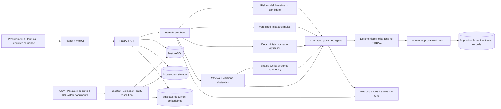
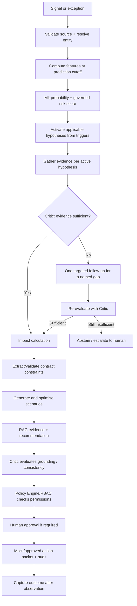

# ProcuraX architecture

## Architecture principles
- One complete supplier-risk decision loop before platform expansion.
- Separate numerical prediction, business formulas, optimisation, language generation, orchestration and authorisation.
- Use explicit API contracts and typed domain objects.
- Default to synthetic/demo mode until external integrations have been deliberately configured.
- The Critic is a reusable evidence-sufficiency mechanism with context-specific policies; it is not the Policy Engine.

## Container-level view

## Component responsibilities
| Component | Owns | Must not own |
|---|---|---|
| Ingestion/data quality | Source provenance, schema, dates, deduplication, quarantine | Risk decision or LLM-generated numeric truth |
| Feature pipeline | Prediction-time features, time cutoffs | Future outcomes or post-decision labels |
| ML risk service | Calibrated disruption probability, model/version/drivers | Contract authority or action permissions |
| Governed risk mapping | Documented 0–100 score mapping with frozen configuration | Unlogged ad hoc score changes |
| Impact engine | Inventory runway, affected network, exposure formulas | LLM numerical arithmetic |
| Optimiser | Feasible options, objective values, constraints and infeasibility | Free-form LLM selection of solver numbers |
| RAG service | Authorized retrieval, source text/metadata, citations, abstention | Inventing policies or constraints |
| Shared Critic | Sufficient/insufficient + specific gap for diagnostic/RAG/action-condition contexts | Computing risk/financial numbers or authorising actions |
| Agent workflow | States, tools, bounded re-planning, trace/case IDs | Bypassing policy or performing unapproved action |
| Policy Engine/RBAC | Deterministic authorization, threshold, allowed actions | Delegating permission to model/prompt text |
| Approval service | Human decision, reason, status transition | Unlogged material action |
| Outcome service | Post-decision actuals and learning labels | Writing future information into historical features |

## Runtime decision loop

## Boundaries
- UI mock data is illustrative and clearly labelled.
- Feature/business endpoints in this starter return HTTP 501 until implemented.
- `docs/DECISIONS.md` lists implementation defaults and unresolved choices.
- Kubernetes, production ERP write-back, multi-agent ORION, and enterprise scale-out are roadmap only.
