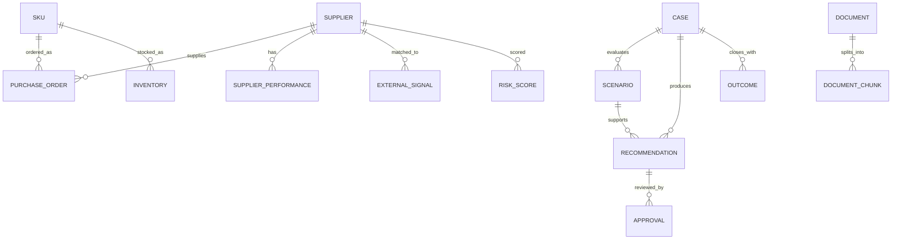

# Data model and storage

## Sources/entities from the v3.5 blueprint
- Supplier master
- SKU/material and plant relationship
- Purchase orders
- Inventory
- Supplier performance (OTIF, lead time, defects, capacity utilisation)
- External signals with source URL/timestamp/credibility
- Risk scores/model versions/drivers
- Cases and candidate scenarios
- Recommendations/evidence references
- Approvals/decision actors/reasons
- Outcomes/actual KPIs/post-event labels
- Documents/chunks/access tags for RAG

## Primary relationships

## Data handling rules
- Store prediction-time features separately from the `outcome` table/store.
- Never train using actual delivery, actual quality, or outcome labels that occur after the prediction timestamp.
- Use temporal train/validation/test splits. The injected SUP-1047 event is held out from training.
- Every imported signal/document must preserve provenance, timestamps, access tags and source tier.
- Track dataset seed, as-of cutoff, generator version, schema version and checksums.
- Numeric money fields use decimal/numeric in the database; never rely on floating-point for persisted INR amounts where exact reconciliation matters.
- The SQL schema in `backend/app/db/schema.sql` is a reviewed starting draft, not a migration already applied to a database.

## Vector storage
Use PostgreSQL + pgvector for document chunks only after selecting an embedding model and its vector dimension. Keep document IDs, version/effective dates, supplier/category tags and ACL filters alongside embedding metadata. Always apply access filters before/with retrieval. Embedding choice and dimensions remain an open decision in `docs/DECISIONS.md`.
